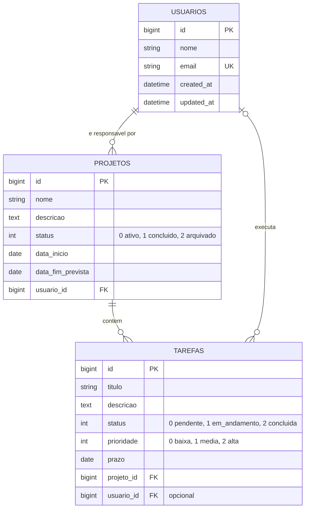
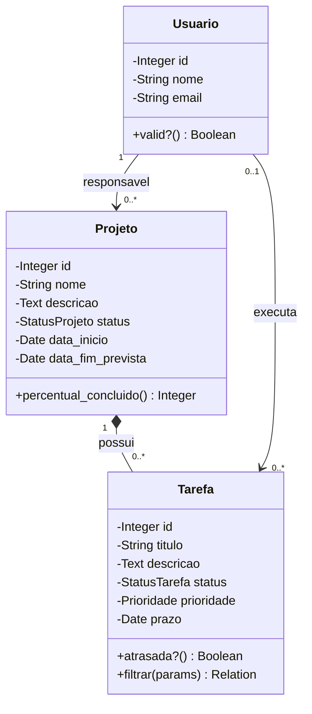
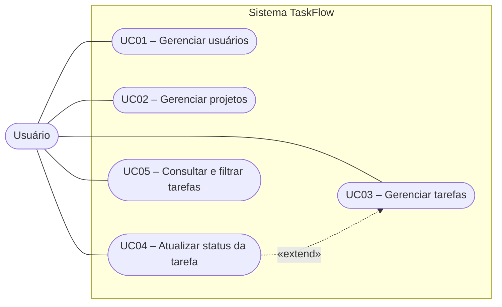
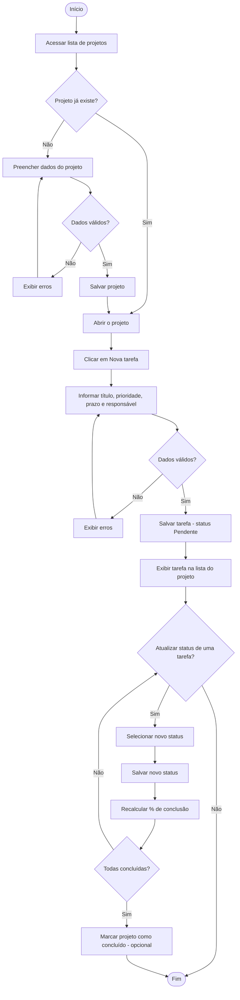
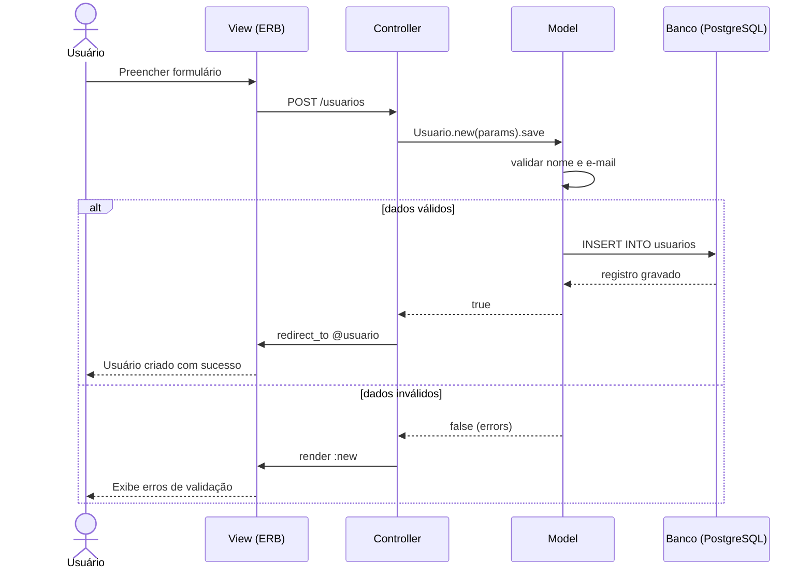
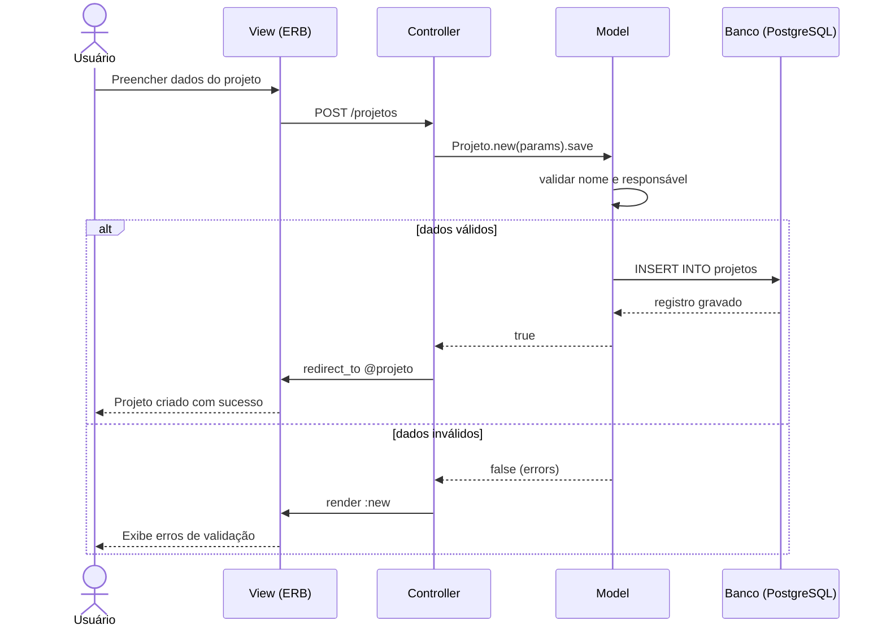
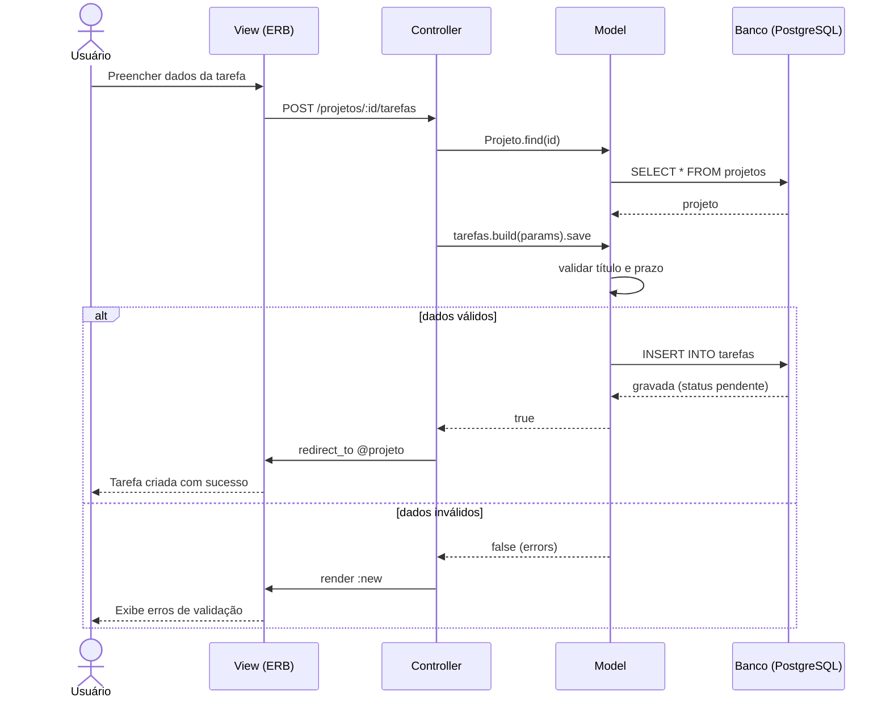
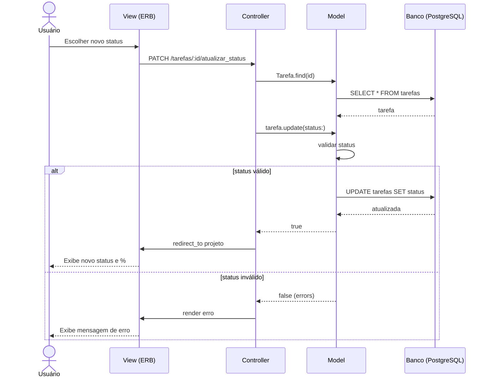
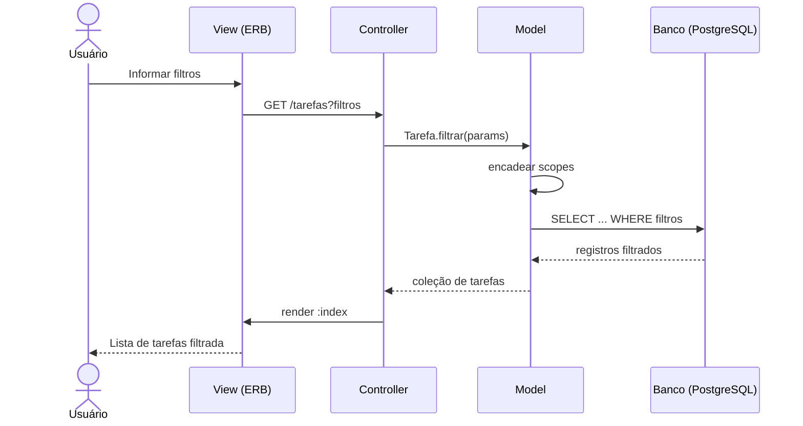

# TaskFlow – Diagramas

### DER

### Diagrama de classes

### Casos de uso

### Atividade (fluxo principal)

### Sequência – UC01 (cadastrar usuário)

### Sequência – UC02 (criar projeto)

### Sequência – UC03 (criar tarefa)

### Sequência – UC04 (atualizar status)

### Sequência – UC05 (consultar e filtrar)

